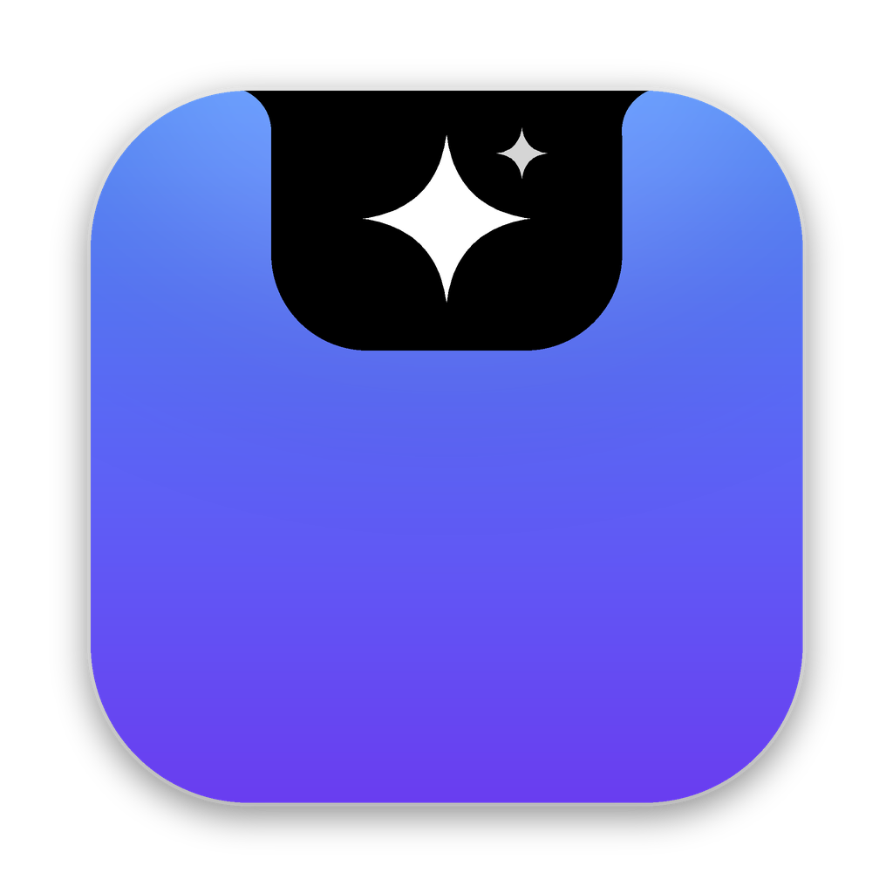

# NotchPilot

**An AI assistant and agent that lives in your MacBook's notch.** Hover over the notch (or press ⇧⌘Space) and it expands into a Dynamic Island–style panel where you can talk to a real tool-using agent — one that starts focus timers, manages your tasks and notes, reads your calendar and finds free time, controls Music and Spotify, opens apps and links, checks what is using your Mac's memory, and remembers your preferences — with explicit, code-enforced permissions and everything stored locally.

Native Swift, SwiftUI and AppKit. No Electron, no web views, no private APIs.

<p align="center"></p>

## Status

| Area | State |
|---|---|
| Core: agent loop, providers, 40 tools, permissions, persistence, timer | ✅ Built and tested — 83 automated tests pass on Linux locally and in GitHub Actions |
| Multi-step agent workflow over real HTTP (mock Anthropic & OpenAI servers) | ✅ Verified end-to-end, including verbatim thinking-block replay and persistence across restarts |
| CLI (`notchpilot-cli`) | ✅ Built; workflow, persistence across processes and missing-credential handling verified |
| macOS app (notch window, SwiftUI UI, EventKit, Keychain, media, notifications) | ⚠️ Fully written and syntax-checked; **not yet compiled** — the GitHub macOS runner never picked up the job during development (see below) |
| Live calls to Anthropic / OpenAI with real keys | ⚠️ Implemented to current API docs; not exercised (no credentials available) |
| Signing / notarisation | Ad-hoc signing only (no Developer ID available) |

**What you need to do:** on your Mac run `cd NotchPilot && swift test && ./scripts/build_app.sh` (Xcode 15.3+), or re-run the *NotchPilot (macOS)* workflow in the Actions tab once macOS runners are available to the repository; then add an API key in Settings. Details and every caveat: [docs/KNOWN_LIMITATIONS.md](docs/KNOWN_LIMITATIONS.md).

## What it does

**The notch**
* A black island that blends into the camera housing, measured from the real display geometry; spring-animated expand/collapse (or a simple fade with Reduce Motion).
* Live activities beside the notch: a focus-timer ring and countdown, album art and equaliser for Music/Spotify, and the agent's status — working, waiting for approval, done (with a one-line result preview).
* Clicks pass through everywhere except the island. It never steals keyboard focus unless you click the message box or use the shortcut, and hands focus back when it closes.
* Works on displays without a notch (a small island in the menu bar), across Spaces and next to full-screen apps. Menu-bar item and global shortcut as alternative entry points.

**The assistant**
* Streaming chat with Markdown, live progress notes while it works, a status chip for every tool call, inline **approval cards** for consequential actions, a live plan for multi-step requests, Stop (⌘.), Retry, Copy, history with search, and document attachments (PDF, Word, RTF, text, Markdown, code…).
* Three modes: **Ask before every change**, **Standard**, **Autonomous** (larger step budget and a live plan; consequential actions still ask).
* Providers: **Anthropic Claude** (default `claude-opus-5-5`), **OpenAI** (Responses API), or any **OpenAI-compatible** server such as Ollama. Keys live in the macOS Keychain.

**Built-in tools** — tasks, notes, focus/break timers, preferences, approved long-term memory, conversation search, daily overview, calendar events, free-time search, calendar events and reminders (with approval), open apps and links, system/battery/top-memory processes, now playing and playback control, Shortcuts, clipboard, email drafts (never sent), date extraction and attached-document reading. Full list: [docs/ARCHITECTURE.md](docs/ARCHITECTURE.md#tools).

**Designed to feel like part of macOS** — the system font and SF Symbols throughout; macOS system colours and your own accent colour (System Settings → Appearance); standard Mac push buttons, switches and spinners; Messages-style chat bubbles; approval prompts worded like the system's ("Don’t Allow" / "Allow"); and a settings window laid out like System Settings, with coloured sidebar icons and grouped sections. The island stays black like the hardware notch, Dynamic Island–style, unless you choose *Match system appearance*.

**Around the assistant** — Today dashboard (timer, now playing, next events, focus list, battery/memory/disk), Tasks with priorities and due dates, Notes with search and “Summarise / Make tasks”, an Activity log of every action, and proactive notifications (morning briefing, deadline reminders, event preparation, end-of-day summary, focus-session end) — each optional.

## Try it

**Without a Mac:** open [`preview/NotchPilot-Preview.html`](preview/NotchPilot-Preview.html) in a browser for an interactive simulation of the notch, assistant, menu-bar item and Settings window. Its replies are scripted and all data is sample data; nothing is sent anywhere.

After adding a key (Settings → AI Provider):

* “Summarise my day and tell me what I need to prioritise.”
* “Give me 25 minutes to finish my economics essay, then remind me to take a break.”
* “Turn these notes into three tasks for tomorrow: …”
* “What do I have scheduled this afternoon?” / “Find a suitable time for a study session.”
* “Summarise this text and save the important points to my notes: …”
* “Start playing music.” / “Open Safari and go to apple.com.”
* “Help me plan my week around my deadlines.”
* “Explain what is using the most memory on my Mac.”
* “Remember that I prefer short, direct answers.”

## Documentation

| | |
|---|---|
| [docs/SETUP.md](docs/SETUP.md) | Requirements, building, first launch, shortcuts, CLI, uninstall |
| [docs/AI_PROVIDERS.md](docs/AI_PROVIDERS.md) | Configuring Anthropic, OpenAI and compatible servers; costs; what is sent |
| [docs/PRIVACY_AND_PERMISSIONS.md](docs/PRIVACY_AND_PERMISSIONS.md) | Data storage, macOS permissions, the permission policy, prompt-injection defences, memory controls |
| [docs/ARCHITECTURE.md](docs/ARCHITECTURE.md) | Modules, agent loop, providers, tools, persistence, window management |
| [docs/TESTING.md](docs/TESTING.md) | Test inventory, CI, manual checklist |
| [docs/KNOWN_LIMITATIONS.md](docs/KNOWN_LIMITATIONS.md) | What is untested, blocked or out of scope |

## Project layout

```
NotchPilot/
├─ Package.swift                    SwiftPM: NotchPilotCore, NotchPilot (macOS app), notchpilot-cli
├─ Sources/NotchPilotCore/          platform-independent agent, providers, tools, stores (tested on Linux + macOS)
├─ Sources/NotchPilot/              the macOS app (AppKit window + SwiftUI + macOS integrations)
├─ Sources/NotchPilotCLI/           terminal front end
├─ Tests/NotchPilotCoreTests/       83 unit and end-to-end tests (+ mock LLM server)
├─ Resources/                       Info.plist, entitlements, app icon
├─ scripts/build_app.sh             builds, signs and zips NotchPilot.app
├─ scripts/make_icon.py             renders the icon
├─ preview/NotchPilot-Preview.html  interactive browser simulation (scripted, sample data)
└─ docs/
```

CI: [`.github/workflows/notchpilot-macos.yml`](../.github/workflows/notchpilot-macos.yml).
